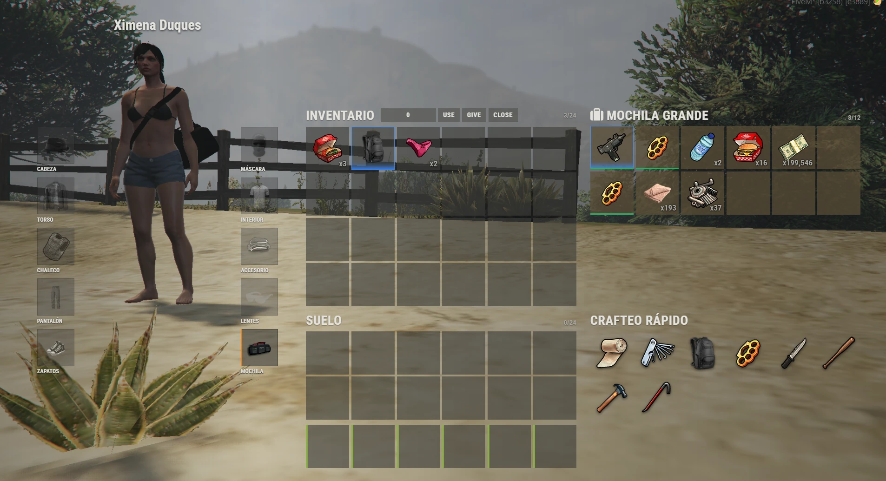
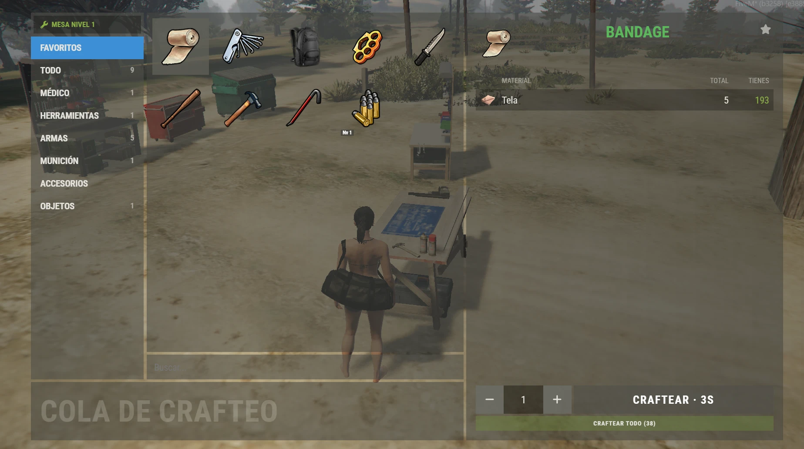
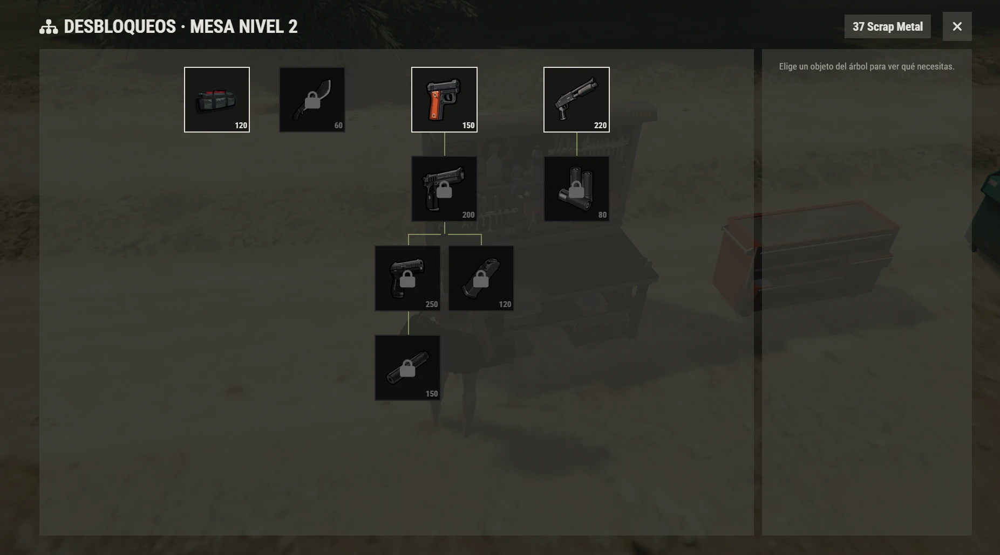
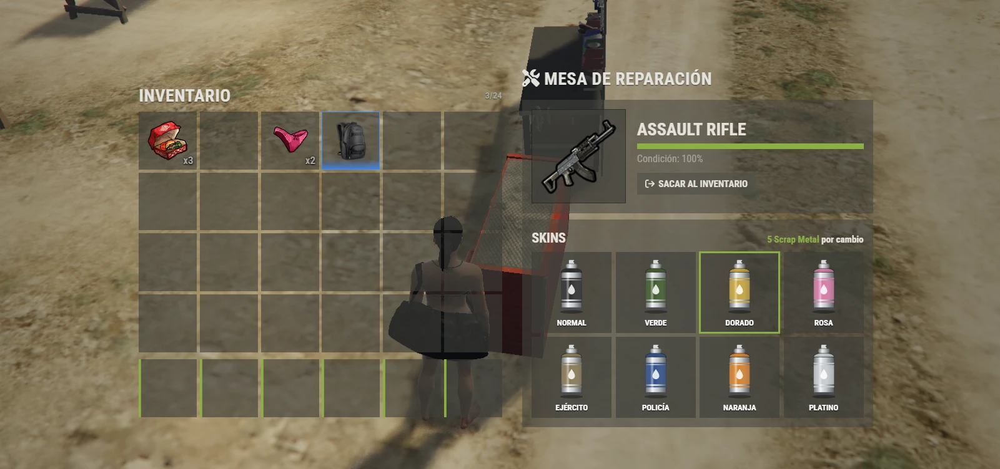
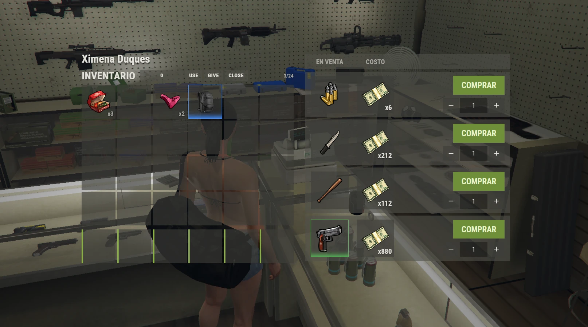

<div align="center">

# Dluckys ox_inventory

**Rediseño de [ox_inventory](https://github.com/overextended/ox_inventory) con estilo de supervivencia para Qbox (FiveM)**

Inventario por ranuras sin peso, ropa con el personaje, mochilas, mesas de trabajo por niveles con árbol de desbloqueos, mesa de reparación con skins y reciclador.

</div>



## Capturas

| Crafteo en la mesa de trabajo | Árbol de desbloqueos |
|---|---|
|  |  |

| Mesa de reparación y skins | Tienda |
|---|---|
|  |  |

## Qué incluye

- **Inventario:** 24 ranuras sin límite de peso, barra rápida de 6 (teclas 1-6), suelo de 24 ranuras debajo del inventario.
- **Ropa y personaje:** prendas alrededor del personaje con cámara centrada en el hueco; arrastra una prenda para ponértela o quitártela.
- **Mochilas:** ranura de mochila junto a la ropa; sus ranuras extra salen a la altura del inventario.
- **Crafteo rápido:** solo lo básico (vendas, ganzúa, mochila pequeña, armas simples) desde el inventario.
- **Mesas de trabajo nivel 1, 2 y 3** (ox_target): *Craftear* abre la pantalla completa de crafteo; *Desbloquear* abre el árbol de su nivel, pagado con chatarra.
- **Mesa de reparación** (ox_target): el objeto pasa a la mesa, se repara o se pinta con 8 colores (latas de spray) y se saca al inventario.
- **Reciclador** (ox_target): entrada de 6 ranuras, botón encender/apagar, salida de 6 ranuras.
- **Contenedores** (stash, maletero, basurero, tienda): tu inventario y el contenedor centrados, sin ropa ni cámara.

## Requisitos

- [Qbox](https://github.com/Qbox-project) (`qbx_core`), [ox_lib](https://github.com/overextended/ox_lib) y [ox_target](https://github.com/overextended/ox_target)
- MySQL (oxmysql)

## Instalación

1. Copia la carpeta en `resources/[ox]/ox_inventory` (reemplaza la original).
2. En `server.cfg`, después de `ensure ox_inventory`:
   ```cfg
   exec @ox_inventory/inventory.cfg
   ```
3. Reinicia el servidor completo.
4. Coloca las mesas con `/admininventory` (mesas de trabajo 1-3, mesa de reparación y reciclador).

La interfaz ya va compilada en `web/build`. Su código fuente está en [dluckys-ox_inventory-ui](https://github.com/DluckysCode/dluckys-ox_inventory-ui) (rama `dluckys-rust`).

## Configuración

| Archivo | Qué se cambia |
|---|---|
| `inventory.cfg` | Ranuras (`inventory:slots 31` = 6 barra rápida + 24 inventario + 1 mochila), ranuras del suelo, teclas… |
| `data/rust_crafting.lua` | Recetas, categorías, mesas y sus modelos, árbol (`unlock = { cost, after }`), reparar, skins, reciclador |
| `data/rust_backpack.lua` | Tipos de mochila y ranuras extra |
| `data/rust_clothing.lua` | Ranuras de ropa y cámara |

## Créditos y licencia

Basado en **[ox_inventory](https://github.com/overextended/ox_inventory)** de [Linden](https://github.com/thelindat), [Luke](https://github.com/LukeWasTakenn), [Dunak](https://github.com/dunak-debug) y colaboradores.
Este proyecto mantiene la licencia **[GPL-3.0](./LICENSE)** del original. Consulta [NOTICE.md](./NOTICE.md) para los avisos legales del proyecto original.

Las modificaciones respecto a ox_inventory están documentadas en esta página y en el historial de commits de este repositorio.
